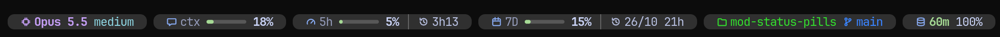
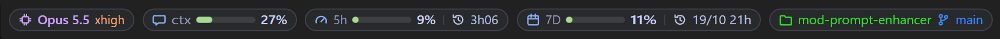

# Status Pills

[English](README.md) · **Português (Brasil)**

Uma faixa de pílulas colada no prompt do Claude Code, com o que a status line mostra, num visual mais limpo: modelo, contexto, limites de uso, projeto e branch. No terminal ela fica logo abaixo do prompt; na aba Code do app desktop, logo acima da caixa de texto.

**No terminal**



**No app desktop**



## O que as pílulas mostram

| Pílula | O que mostra | Exemplo |
| --- | --- | --- |
| Modelo | Modelo e nível de esforço | `Opus 5.5 xhigh` |
| Contexto | Quanto da janela de contexto já foi usado, com barra | `ctx 24%` |
| Limite de 5 horas | Uso, com barra, e o tempo que falta para renovar | `5h 8% · 3h09` |
| Limite de 7 dias | Uso, com barra, e o dia/mês e a hora da renovação | `7D 11% · 19/10 21h` |
| Projeto | Pasta do projeto e branch do git | `mod-status-pills main` |

As barras ficam verdes abaixo de 50%, amarelas abaixo de 80% e vermelhas daí para cima. Numa janela estreita as barras encurtam primeiro; se ainda não couber, as pílulas descem para uma segunda linha, com as duas linhas centralizadas.

## Instalar

O Status Pills se instala pelo seu identificador, `status-pills`, a partir do [WPC Mods for Claude](https://github.com/carreirodev/wpc-mods-claude/blob/main/README.pt-BR.md), o marketplace com todos os meus mods. Numa sessão do Claude Code, digite:

```
/plugin install status-pills --marketplace carreirodev/wpc-mods-claude
```

Responda `y` para adicionar o marketplace e escolha o escopo de usuário (o primeiro da lista) com Enter. A mensagem `Installed status-pills` confirma; a faixa aparece a partir daí, em toda sessão nova.

Instalou antes pelo marketplace deste repositório (`status-pills@status-pills`)? Essa cópia continua atualizando como antes. Para trocar, siga [estes passos](https://github.com/carreirodev/wpc-mods-claude/blob/main/README.pt-BR.md#se-você-já-instalou-um-mod-pelo-repositório-dele); não fique com as duas, porque só uma roda.

> [!TIP]
> Os ícones no terminal pedem uma [Nerd Font](https://www.nerdfonts.com/). No WSL ou no Linux, veja também [Cores reais no WSL e no Linux](#cores-reais-no-wsl-e-no-linux).

## Atualizar

A atualização não é automática: cada computador que instalou pelo marketplace precisa pedir a versão nova.

1. No terminal, fora do Claude Code, rode:

   ```
   claude plugin update status-pills@wpc-mods-claude
   ```

   A resposta diz de qual versão para qual foi, por exemplo `updated from 0.2.2 to 0.2.3`. Se já estiver na última, ela diz `already at the latest version`.

2. Abra uma sessão nova do Claude Code, ou rode `/reload-plugins` numa sessão já aberta. A sessão que estava aberta durante a atualização continua com a versão antiga até isso.

Dentro de uma sessão, `/plugin marketplace update wpc-mods-claude` faz o mesmo que o passo 1.

O WSL tem a sua própria instalação do Claude Code, separada da do Windows: rode o passo 1 dentro do WSL também.

Para conferir a versão instalada, rode `claude plugin list` e procure `status-pills@wpc-mods-claude`.

Para não ter de lembrar: em `/plugin`, na aba **Marketplaces**, escolha `wpc-mods-claude` e depois **Enable auto-update**. Daí em diante, cada sessão nova busca a versão nova sozinha e avisa com `Plugin updated: status-pills · Run /reload-plugins to apply`.

## Onde as pílulas ficam

### Terminal

As pílulas ficam logo abaixo do prompt. A linha de dicas do Claude Code continua como ele a desenha, acima delas, com uma linha em branco entre as duas. O que outros mods põem embaixo do prompt (o botão do launchpad, por exemplo) também fica, acima ou abaixo das pílulas conforme a ordem em que os mods carregam.

Cada pílula ocupa uma linha, com fundo colorido e pontas arredondadas.

### App desktop

A linha embaixo da caixa de texto é do próprio app (o modo de permissão, o modelo), e ele não deixa os mods desenharem nela. Por isso lá as pílulas ficam na faixa acima da caixa, sempre por último, coladas nela. O que outros mods desenham nessa faixa (os botões do prompt-enhancer, por exemplo) fica acima das pílulas.

As pílulas são desenhadas como figuras, nas cores do tema claro ou escuro.

### Ordem de carregamento

Essa posição depende da ordem em que o Claude Code carrega os mods, que um mod não escolhe. Os mods carregados de uma pasta (`--plugin-dir` ou `CLAUDE_CODE_PLUGIN_DIRS`, como em [Editar o mod](#editar-o-mod)) vêm antes dos instalados pelo marketplace. Vindo antes, o Status Pills recebe a faixa dos outros pronta e se põe embaixo dela.

Instalado pelo marketplace, ele entra na fila dos outros mods instalados, na ordem que o Claude Code decidir. Um mod que venha antes dele e desenhe a faixa sozinho, sem deixar os de baixo desenharem, esconde as pílulas no desktop (o prompt-enhancer 0.2.0 faz isso).

## Cores reais no WSL e no Linux

No WSL e no Linux, o Claude Code só usa cores reais quando o terminal anuncia que as tem. Confira com `echo $COLORTERM`: se não aparecer `truecolor`, as cores são reduzidas a uma paleta de 256, e os ícones e as barras perdem o tom exato.

Se o terminal desenha cores reais, como o Windows Terminal, acrescente `export COLORTERM=truecolor` ao `~/.bashrc` (ou ao `~/.zshrc`) e abra um terminal novo antes de iniciar o Claude Code.

## Editar o mod

Para mexer no mod, use a pasta clonada em vez da instalação acima (um jeito ou o outro, não os dois):

1. Clone o repositório:

   ```
   git clone https://github.com/carreirodev/mod-status-pills.git C:\Users\SEU_USUARIO\mods\status-pills
   ```

2. Em `~/.claude/settings.json`, no bloco `env`, acrescente essa pasta a `CLAUDE_CODE_PLUGIN_DIRS`. Várias pastas são separadas por `;` no Windows:

   ```json
   "env": {
     "CLAUDE_CODE_PLUGIN_DIRS": "C:\\Users\\SEU_USUARIO\\mods\\agents-panel;C:\\Users\\SEU_USUARIO\\mods\\status-pills"
   }
   ```

3. Abra uma sessão nova. Daí em diante, cada mudança salva na pasta recarrega o mod ao fim da resposta do Claude.

Antes de subir uma mudança, rode na pasta do mod:

```
claude plugin validate .
claude plugin test .
```

E aumente `version` em `.claude-plugin/plugin.json`: os computadores que instalaram pelo marketplace só recebem a mudança quando a versão muda.
